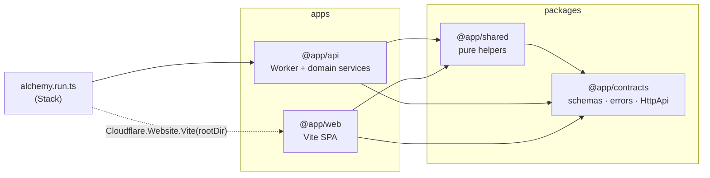
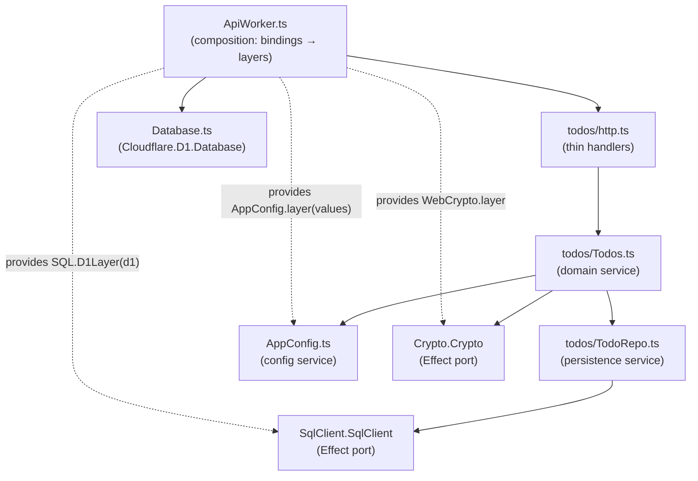
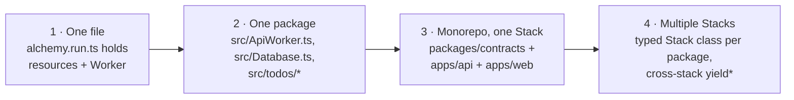

# 02: Project structure

This is the layout the boilerplate uses. It combines three sources: Alchemy's official
file-layout rules, t3code's package graph and service-module conventions, and the
`t3code/infra/relay` Worker. See [01](./01-reference-codebases.md) for those sources.

## The tree

This is the tree `create-effect-alchemy` generates. Every file listed here exists in
[`template/`](../template).

```
.
├── alchemy.run.ts                # Composition root: the Stack. Thin.
├── package.json                  # Workspace root: dev / deploy / check / sync:repos scripts
├── pnpm-workspace.yaml           # Workspaces + catalog (pin effect once) + overrides (pnpm only)
├── tsconfig.base.json            # Strict options + @effect/language-service diagnostics
├── tsconfig.json                 # Root project: alchemy.run.ts, vitest.config.ts, scripts/
├── vitest.config.ts              # `unit` and `integ` projects
├── .oxlintrc.json  .oxfmtrc.json
├── knip.jsonc                    # Unused exports/deps fail the check
├── .env.example                  # Every config key the Stack reads, documented
├── AGENTS.md                     # Rules for coding agents (CLAUDE.md -> @AGENTS.md)
├── scripts/sync-repos.ts         # Clones effect + alchemy into .repos/ at the installed versions
├── .repos/                       # gitignored: those reference clones, read-only
├── docs/                         # These docs
│
├── packages/
│   └── contracts/                # @app/contracts: wire types only, no runtime logic
│       ├── package.json          # "exports": { "./api": ..., "./health": ..., "./ids": ..., "./todos": ... }
│       └── src/
│           ├── ids.ts            # Branded IDs: TodoId
│           ├── health.ts         # HealthGroup
│           ├── todos.ts          # Todo, CreateTodo, TodoNotFound, TodoLimitReached, TodosGroup
│           └── api.ts            # AppApi = HttpApi.make("app").add(HealthGroup).add(TodosGroup)
│   (add packages/shared/ only when two packages need the same pure helper)
│
└── apps/
    ├── api/                      # @app/api: the Cloudflare Worker
    │   ├── package.json
    │   ├── tsconfig.json         # lib: WebWorker, types: @cloudflare/workers-types
    │   ├── migrations/           # 0001_create_todos.sql ... applied by Cloudflare.D1.Database
    │   ├── src/
    │   │   ├── ApiWorker.ts      # The Worker: 1) bind resources 2) read config 3) compose layers -> { fetch }
    │   │   ├── Database.ts       # export const Database = Cloudflare.D1.Database("Database", {...})
    │   │   ├── AppConfig.ts      # AppConfig service + `fromEnv` Config reads
    │   │   ├── WebCrypto.ts      # Adapter: effect/Crypto backed by the Workers Web Crypto API
    │   │   ├── health/http.ts    # Handlers for the health group
    │   │   ├── todos/            # A domain folder: flat, one module per service, tests next to code
    │   │   │   ├── Todos.ts          # Domain service (business rules)
    │   │   │   ├── Todos.test.ts
    │   │   │   ├── TodoRepo.ts       # Persistence service, written against SqlClient (a port)
    │   │   │   ├── http.ts           # HttpApiBuilder.group(AppApi, "todos", ...): thin handlers
    │   │   │   └── http.test.ts      # The HTTP pipeline, in memory, through HttpApiTest
    │   │   └── testing/
    │   │       └── TestDatabase.ts   # In-memory SQLite SqlClient running migrations/*.sql
    │   └── test/
    │       └── api.integ.test.ts # Deploys the Stack (alchemy/Test/Vitest), calls it with HttpApiClient
    │
    └── web/                      # @app/web: Vite SPA, deployed by Cloudflare.Website.Vite
        ├── package.json
        ├── vite.config.ts
        ├── index.html
        └── src/
            ├── main.tsx          # RegistryProvider + App
            ├── lib/ApiClient.ts  # AtomHttpApi.Service over AppApi: the app's one API client + runtime
            └── todos/
                ├── atoms.ts      # ApiClient.query / ApiClient.mutation atoms
                └── TodoList.tsx
```

## What each piece owns

| Piece | Owns | Must not |
| --- | --- | --- |
| `alchemy.run.ts` | Stack name, `providers`, `state`, yielding the top-level units, returning outputs | Hold resource definitions, runtime code, or stage `if`s. If it grows, a unit is missing a home in `src/` (Alchemy `file-layout.mdx`) |
| `packages/contracts` | `Schema` models, branded IDs, `Schema.TaggedError`s that cross the wire, `HttpApi`/`HttpApiGroup`/`RpcGroup` definitions, middleware *tags* | Import from `apps/*`; run I/O; implement middleware. Its only dependency is `effect` |
| `packages/shared` | Pure, platform-neutral helpers used by two or more packages | Exist before it's needed. No root barrel: one subpath export per module |
| `apps/api/src/ApiWorker.ts` | Binding resources, reading `Config`, adapting bindings into layers, composing the runtime layer, serving the API | Contain business rules. It is wiring only |
| `apps/api/src/<Resource>.ts` | One Alchemy resource declaration, or a group of resources that share a lifecycle | Import runtime/domain code |
| `apps/api/src/<domain>/` | Services for one domain, their errors, their tests, and the domain's `http.ts` handlers | Import `alchemy/*` or read `process.env`. Depend on Effect services (ports) instead |
| `apps/api/test/` | Deploy-level tests that run the real Stack | Mock things. Unit tests are colocated in `src/` |
| `apps/web` | UI. One API client (`lib/ApiClient.ts`, an `AtomHttpApi.Service` that owns the app's runtime), typed from `@app/contracts` | Create a runtime per feature, or hand-write fetch calls for endpoints that exist in the contract |

## Dependency rules



Arrows point from the importer to what it imports. Imports only go up toward `contracts`. Nothing
imports from `apps/*` except `alchemy.run.ts`, which imports the Worker class to deploy it.

Inside `apps/api`, the same idea applies at file level:



- Domain modules (`todos/*`) depend on **Effect services**: `SqlClient`, `AppConfig`, other domain
  services. They never depend on a Cloudflare binding.
- `ApiWorker.ts` is the only file that knows those services come from D1, KV, Queues, or env vars.
  It turns each binding into a layer: `SQL.D1Layer(d1)`, `Layer.succeed(Port, {...})`, or a named
  adapter like `layerCloudflareQueues(sender)` (the relay's pattern).
- So in unit tests the same services run on in-memory SQLite or a `layerMemory`, with no Cloudflare
  involved.

## File naming

| Kind | Name | Example |
| --- | --- | --- |
| Service module | PascalCase, named after the service | `Todos.ts`, `TodoRepo.ts`, `AppConfig.ts` |
| Service test | Next to the module | `Todos.test.ts` |
| Domain HTTP handlers | `http.ts` in the domain folder (t3code: `project/http.ts`) | `todos/http.ts` |
| Alchemy resource | PascalCase, named after the logical ID | `Database.ts` → `Cloudflare.D1.Database("Database")` |
| Alchemy Worker | PascalCase, named after the logical ID; file is its own entry (`main: import.meta.url`) | `ApiWorker.ts` |
| Contract module | camelCase per domain (t3code style) | `contracts/src/todos.ts` |
| Pure helper | camelCase | `shared/src/slugify.ts` |
| Deploy test | `*.integ.test.ts` under `test/` | `test/api.integ.test.ts` |

Relative imports carry the `.ts` extension (`import * as Todos from "./Todos.ts"`). This is
required for Node's type stripping and matches all three reference repos.

## Growth path

Start smaller than the tree above if you're prototyping, and split when it starts to hurt.



1. **One file.** Alchemy's own docs call this "a perfectly good starting point."
2. **One package.** Split as soon as the file holds runtime code: a Worker module, resource
   modules, domain folders. The contract can live in `src/api.ts` at this stage.
3. **Monorepo, one Stack** *(the boilerplate default)*. Move the contract to `packages/contracts`
   when a second consumer appears: a web app, a CLI, or tests that call the API.
4. **Multiple Stacks.** Only do this when packages deploy on different schedules or are owned by
   different teams, when the backend has outside consumers, or when you need to destroy pieces
   independently (Alchemy `monorepo.mdx`). Each package gets its own `alchemy.run.ts`, and the
   backend exports `class Backend extends Alchemy.Stack<Backend, { url: string }>()("Backend")`.

## Path anchoring in a monorepo

The Alchemy CLI runs from the workspace root, so every path a resource reads must be anchored to
the file that declares it (Alchemy `monorepo-single-stack.mdx`):

| Declaring | Use |
| --- | --- |
| A Worker whose file is its own entry | `main: import.meta.url` |
| A Worker with a separate entry file | `main: new URL("./worker.ts", import.meta.url).href` |
| A Vite site in a subdirectory | `rootDir: path.resolve(import.meta.dirname, "apps/web")` |
| D1 migrations | `migrations: "./apps/api/migrations"`. Relative paths resolve against `process.cwd()` (`alchemy/src/Cloudflare/D1/Database.ts:683`), which is the workspace root. Don't use `import.meta` here: `Database.ts` is also bundled into the Worker, where it isn't a file URL |
