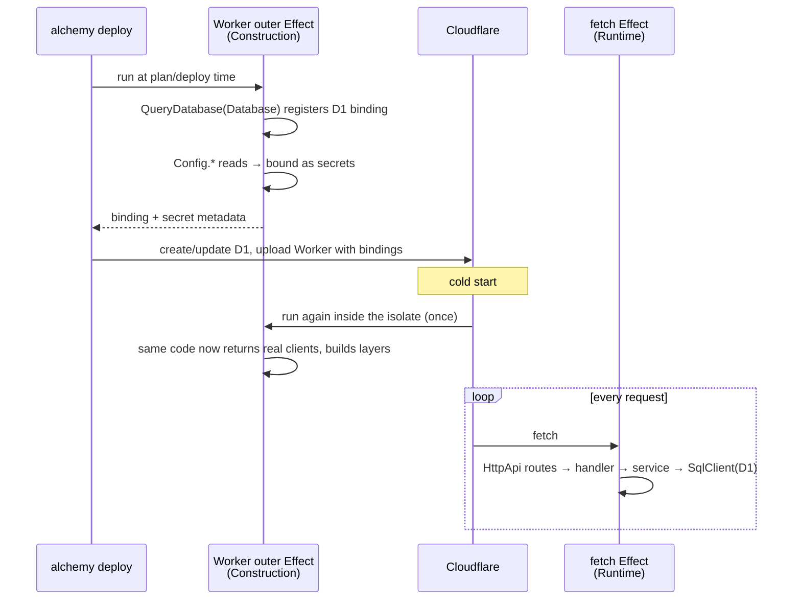

# 04: Alchemy patterns

Alchemy v2 is "Infrastructure-as-Effects". Cloud resources, Workers, and the code inside them are
one type-safe Effect program. This doc covers how the boilerplate uses it.

Sources:
- Alchemy's `AGENTS.md`
- `website/src/content/docs/**`
- `examples/**`
- t3code's `infra/relay`

> **Alchemy v2 is in beta.** Pin the exact version in the catalog (the relay pins
> `2.0.0-beta.80`) and read the changelog before you bump it.

## Vocabulary

| Term | Meaning |
| --- | --- |
| **Stack** | A named collection of resources, deployed together. The default export of `alchemy.run.ts` |
| **Stage** | One instance of a Stack: `prod`, `pr-42`, `dev_justin`. Each stage has its own resources and state |
| **Resource** | A declared cloud thing (`Cloudflare.D1.Database("Database")`). Declaring it does nothing; it is provisioned when a Stack yields it. It is memoized by **logical ID** |
| **Output** | A lazy reference to a resource attribute (`api.url`). `.as<string>()` narrows its type |
| **Binding** | A capability a Worker requests (`Cloudflare.D1.QueryDatabase(db)`). At deploy time it adds the native binding. At runtime it returns a typed client |
| **Provider** | A layer that knows how to create, update, and delete one cloud's resources (`Cloudflare.providers()`) |
| **State store** | Where Alchemy records what it deployed (`Alchemy.localState()`, `Cloudflare.state()`) |

## `alchemy.run.ts`: the composition root

```ts
// alchemy.run.ts
import * as Alchemy from "alchemy";
import * as Cloudflare from "alchemy/Cloudflare";
import * as Effect from "effect/Effect";
import * as Layer from "effect/Layer";
import * as Path from "effect/Path";

import ApiWorker from "./apps/api/src/ApiWorker.ts";

/**
 * `alchemy dev` keeps state on disk (.alchemy/), so it runs with no cloud setup.
 * Deploys keep state in your Cloudflare account, so CI and teammates share it.
 */
const state = Layer.unwrap(
  Effect.gen(function* () {
    const { dev } = yield* Alchemy.AlchemyContext;
    return dev ? Alchemy.localState() : Cloudflare.state();
  }),
);

// Composition root: name the Stack, pick providers and state, wire units, return outputs.
// Resources and runtime code live in apps/*; if this file grows, something is missing a home.
export default Alchemy.Stack(
  "EffectAlchemyApp",
  { providers: Cloudflare.providers(), state },
  Effect.gen(function* () {
    const path = yield* Path.Path;
    const api = yield* ApiWorker;

    const web = yield* Cloudflare.Website.Vite("Web", {
      rootDir: path.resolve(import.meta.dirname, "apps/web"),
      env: { VITE_API_URL: api.url.as<string>() },
    });

    return {
      apiUrl: api.url.as<string>(),
      webUrl: web.url.as<string>(),
    };
  }),
);
```

According to Alchemy's `file-layout.mdx`, this file has exactly four jobs:

1. Name the Stack.
2. Merge providers. Use `Layer.mergeAll(Cloudflare.providers(), Drizzle.providers(), ...)` when
   you need more than one.
3. Pick a state store.
4. Wire units together and return outputs.

The Worker pulls in its own database. Yielding `ApiWorker` provisions everything the Worker binds,
so `alchemy.run.ts` doesn't need to list each resource.

**State follows the mode.** `state` is a `Layer.unwrap` that reads `Alchemy.AlchemyContext`:
- `alchemy dev` and `Test.make({ dev: true })` get `Alchemy.localState()`, so local work needs no
  Cloudflare account.
- Deploys get `Cloudflare.state()`, which CI and teammates share.

Read `AlchemyContext.dev`, not the `ALCHEMY_DEV` env var. The test harness switches dev mode
through the context and never sets the env var, so a Stack keyed on the env var would ask for
Cloudflare credentials inside tests.

## Resource declarations

Give each resource its own module, or group resources that **share a lifecycle**:

```ts
// apps/api/src/Database.ts
import * as Cloudflare from "alchemy/Cloudflare";

/**
 * The app's D1 database. Migrations are applied in order on every deploy and
 * already-applied files are skipped. The path is relative to the repo root,
 * where `alchemy.run.ts` lives and the Alchemy CLI runs.
 */
export const Database = Cloudflare.D1.Database("Database", {
  migrations: "./apps/api/migrations",
});
```

```ts
// Grouped: these change together (from Alchemy's file-layout docs)
export const NeonDb = Effect.gen(function* () {
  const schema = yield* Drizzle.Schema("app-schema", { schema: "./src/schema.ts", out: "./migrations" });
  const project = yield* Neon.Project("app-db", { region: "aws-us-east-1" });
  const branch = yield* Neon.Branch("app-branch", { project, migrations: schema });
  return { project, branch, schema };
});
```

- **Wrap groups in an `Effect`, not in the Stack.** An exported `Effect.gen` can be yielded from
  anywhere, and memoization means the resources are provisioned once.
- **Don't anchor resource paths with `import.meta`.** A resource module is imported by the Worker,
  so it's bundled into the Worker too, and in workerd `import.meta.url` isn't a file URL. Use paths
  relative to the repo root, where the CLI runs.
- **Put stage-specific choices next to the resource they affect, not in `alchemy.run.ts`:**
  ```ts
  const { stage } = yield* Alchemy.Stack;
  // ... then pick sizes or names based on stage, e.g. .pipe(RemovalPolicy.retain(stage === "prod"))
  ```
  For module-scope props, use `Stack.useSync((stack) => ({ ... }))`.

## Worker anatomy

A Worker module holds both its declaration and its runtime code. `main: import.meta.url` makes the
file its own entrypoint, so there's no `wrangler.toml`.

```ts
// apps/api/src/ApiWorker.ts
import { AppApi } from "@app/contracts/api";
import * as Cloudflare from "alchemy/Cloudflare";
import * as Http from "alchemy/Http";
import * as SQL from "alchemy/SQL/D1";
import * as Effect from "effect/Effect";
import * as HttpRouter from "effect/http/HttpRouter";
import * as HttpApiBuilder from "effect/http-api/HttpApiBuilder";
import * as HttpApiScalar from "effect/http-api/HttpApiScalar";
import * as Layer from "effect/Layer";

import * as AppConfig from "./AppConfig.ts";
import { Database } from "./Database.ts";
import * as HealthHttp from "./health/http.ts";
import * as TodoRepo from "./todos/TodoRepo.ts";
import * as Todos from "./todos/Todos.ts";
import * as TodosHttp from "./todos/http.ts";
import * as WebCrypto from "./WebCrypto.ts";

/**
 * The API Worker. Its outer Effect runs at deploy time (to register bindings and
 * config) and once per cold start (to build the app). `fetch` runs per request.
 * This file is wiring only: business rules live in the domain folders.
 */
export default class ApiWorker extends Cloudflare.Worker<ApiWorker>()(
  "ApiWorker",
  { main: import.meta.url },
  Effect.gen(function* () {
    //
    // 1. Bind infrastructure: registers the D1 binding at deploy, returns a client at runtime.
    //
    const d1 = yield* Cloudflare.D1.QueryDatabase(Database);

    //
    // 2. Read config: anything yielded here is bound into the Worker as a secret.
    //
    const config = yield* AppConfig.fromEnv;

    //
    // 3. Compose the runtime: domain services on top, platform adapters at the bottom.
    //
    const layerRuntime = Layer.empty.pipe(
      Layer.provideMerge(Todos.layer),
      Layer.provideMerge(TodoRepo.layer),
      Layer.provideMerge(SQL.D1Layer(d1)),
      Layer.provideMerge(AppConfig.layer(config)),
      Layer.provideMerge(WebCrypto.layer),
    );

    const fetch = Layer.mergeAll(
      HttpApiBuilder.layer(AppApi, { openapiPath: "/openapi.json" }).pipe(
        Layer.provide([HealthHttp.layer, TodosHttp.layer]),
      ),
      HttpApiScalar.layer(AppApi, { path: "/docs" }),
      HttpRouter.cors({ allowedOrigins: config.allowedOrigins }),
    ).pipe(Layer.provide(layerRuntime), Layer.provide(Http.Platform), HttpRouter.toHttpEffect);

    return { fetch };
  }).pipe(Effect.provide(Cloudflare.D1.QueryDatabaseBinding)),
) {}
```

### Two phases



- **The outer generator runs twice:** once at plan/deploy time, and once per cold start inside
  the isolate. It binds resources, reads Config, and builds layers. It must not do request work.
- **The inner `fetch` runs per request.** Runtime-only binding methods need
  `Alchemy.RuntimeContext`, so the type system stops you from calling them during Construction.
- **Don't acquire disposable resources during Construction on workerd.** That means connections,
  pools, and finalizers; Alchemy's `AGENTS.md` calls this "Isolate scope vs request scope".
  Acquire them per request. `SQL.D1Layer` already does this: it builds the D1 client lazily once
  per execution.

### Bindings

| Resource | Client (yield in Construction) | Layer to provide on the outer Effect |
| --- | --- | --- |
| D1 | `Cloudflare.D1.QueryDatabase(db)` → `SQL.D1Layer(d1)` / `SQL.D1(d1)` | `Cloudflare.D1.QueryDatabaseBinding` |
| R2 | `Cloudflare.R2.ReadBucket` / `WriteBucket` / `ReadWriteBucket(bucket)` | `Cloudflare.R2.ReadWriteBucketBinding` (etc.) |
| KV | `Cloudflare.KV.ReadNamespace(ns)` / `ReadWriteNamespace(ns)` | `Cloudflare.KV.ReadWriteNamespaceBinding` (etc.) |
| Queue (producer) | `Cloudflare.Queues.WriteQueue(queue)` | `Cloudflare.Queues.WriteQueueBinding` |
| Queue (consumer) | `yield* Cloudflare.Queues.consumeQueueMessages(queue, opts, (stream) => ...)` | `Cloudflare.Queues.EventSourceLive` |
| Hyperdrive | `Cloudflare.Hyperdrive.Connect(hd)` | `Cloudflare.Hyperdrive.ConnectBinding` |
| Cron | `yield* Cloudflare.Workers.cron("*/5 * * * *", () => effect)` | `Cloudflare.Workers.CronEventSourceLive` (the relay provides it) |
| Durable Object | `const objs = yield* MyObject; objs.getByName(id).method()` | None: yield the DO class |

Use the narrowest binding that works: `Read` or `Write` rather than `ReadWrite`. When you need
several binding layers, combine them:
`Effect.provide(Layer.mergeAll(A.Binding, B.Binding))`, or use the relay's
`Layer.empty.pipe(Layer.provideMerge(...))` chain.

### Bindings are adapters, not dependencies

Domain services never receive a binding. The Worker converts each binding into an Effect service
that the domain already depends on. The relay does this throughout:

```ts
// The domain depends on the HookInbox port (a plain Context.Service)...
// ...and the Worker adapts the Durable Object binding into it:
const layerHookInbox = Layer.succeed(HookInbox.HookInbox, {
  hold: ({ endpointKey, baseUrl, hook }) => hookInboxes.getByName(endpointKey).hold(hook, baseUrl).pipe(/* map errors */),
  wake: ({ endpointKey, baseUrl }) => hookInboxes.getByName(endpointKey).wake(baseUrl).pipe(/* ... */),
  clear: ({ endpointKey }) => hookInboxes.getByName(endpointKey).clear().pipe(/* ... */),
});
```

When an adapter is reused, give it a name and keep it in the port's module:
`ApnsDeliveryQueue.layerCloudflareQueues(sender, ctx)` or
`ManagedEndpointProvider.layerCloudflareBindings(...)`.

## Serving an HttpApi from a Worker

1. `HttpApiBuilder.layer(AppApi)` builds the router from the contract. Provide the handler
   layers to it (`HttpApiBuilder.group(...)` from each domain's `http.ts`).
2. Provide `Http.Platform` from `alchemy/Http`. It stubs the filesystem-backed `HttpPlatform`,
   `Etag`, `Path`, and `FileSystem` that a Worker doesn't have. Some Alchemy docs still hand-write
   an `HttpPlatformStub`; `Http.Platform` replaces it.
3. Pipe into `HttpRouter.toHttpEffect`, and return the result as `fetch`.
4. Optionally serve docs with `HttpApiScalar.layer(AppApi, { path: "/docs" })` and the spec with
   `openapiPath: "/openapi.json"`.

For **RPC** instead of HttpApi, use
`Cloudflare.Workers.RpcWorker<Backend>()("Backend", { main, schema: MyRpcs }, ...)` returning
`RpcServer.toHttpEffect(MyRpcs)`. See `examples/cloudflare-tanstack-rpc-drizzle`.

## Config and secrets

```ts
Effect.gen(function* () {
  const apiKey = yield* Config.Redacted("API_KEY"); // ✅ bound at deploy, available at runtime
  return {
    fetch: Effect.gen(function* () {
      // ❌ a Config read here is never bound to the deployed Worker
    }),
  };
});
```

- **Any `Config` yielded in the outer generator is bound into the Worker,** always as a secret.
  Combinators such as `Config.withDefault` bind the raw value and apply again at runtime.
- **Values come from the process env plus `.env` by default.** Use `--env-file <path>` to choose
  another file. The Stack's optional `secrets` field can plug in a manager, chosen per stage:
  ```ts
  secrets: ({ stage }) => (stage === "prod" ? Doppler.Secrets({ ... }) : Alchemy.Secrets.DotEnv())
  ```
- **Generate deploy-time secrets as resources.** For example
  `Alchemy.makeRandom("SigningSecret", { bytes: 32 })` or `Alchemy.KeyPair("MintKeys")`; the relay
  uses both. Nobody has to copy them around.
- **Document every key in `.env.example`.** The relay's version is a model: it groups keys into
  required and optional, and says where to get each value.

## Stages and state

| Command | Default stage |
| --- | --- |
| `alchemy deploy` / `plan` / `destroy` / `logs` | `live_$USER` |
| `alchemy dev` | `dev_$USER` |
| `Test.make(...)` | `test_$USER` |

The stage is chosen in this order: the `--stage` flag, then `$ALCHEMY_STAGE`, then the default.
Source: `packages/alchemy/src/Cli/commands/flags.ts`. The `stack.mdx` doc is out of date on this.

- **Pass `--stage prod` explicitly** in CI or a deploy script, so prod is never deployed by
  accident.
- **Protect stateful prod resources** with `RemovalPolicy.retain(stage === "prod")`.
- **Personal or PR stages can borrow a prod resource** instead of creating their own, via
  `.ref("LogicalId", { stage: "prod" })`. The relay's `db.ts` does this: it creates a Planetscale
  DB on prod and a branch per other stage.

| State store | Use when |
| --- | --- |
| `Alchemy.localState()` | The template uses it automatically for `alchemy dev` and dev-mode tests. State lives in `.alchemy/`, which is gitignored |
| `Cloudflare.state()` | The template uses it for deploys. Shared and CI deploys need it, since CI runners can't see `.alchemy/`. It bootstraps once per account |
| `inMemoryState()` | Tests only |

## Background work in the same Worker

```ts
yield* Cloudflare.Queues.consumeQueueMessages(EmailQueue, { batchSize: 10, maxRetries: 5 }, (stream) =>
  stream.pipe(
    Stream.runForEach((message) => Mailer.Mailer.pipe(Effect.flatMap((m) => m.send(message.body)))),
    Effect.provide(layerRuntime), // the same runtime the HTTP handlers use
  ),
);

yield* Cloudflare.Workers.cron("*/5 * * * *", () =>
  Cleanup.Cleanup.pipe(
    Effect.flatMap((c) => c.sweep),
    Effect.withSpan("cron.cleanup"),
    Effect.provide(layerRuntime),
  ),
);
```

The relay registers two queue consumers and one cron job this way. All of them share `layerRuntime`
with HTTP. Because of that, a capability written as a service method works from every entry
point.

## Local development

`alchemy dev` re-runs the Stack in watch mode on the `dev_$USER` stage.

- **Workers run in workerd.** KV, R2, D1, Queues, Hyperdrive, Workflows, and Containers get local
  simulators. Anything without a local provider is deployed live to the dev stage.
- **To force a resource to run live during dev,** use `.pipe(Alchemy.remote())`.
- **The default port is `1337`.** Override it with the Worker prop `dev: { port }`.
- **For dev-only behaviour,** use `yield* ALCHEMY_DEV` (exported from `alchemy`).

## Testing deployed Stacks

Unit tests use plain `@effect/vitest` against domain services
([03 §11](./03-effect-patterns.md#11-testing)). Deploy tests run the whole Stack:

```ts
// apps/api/test/api.integ.test.ts
/**
 * Deploys the real Stack and calls it through the typed client.
 *
 * By default this runs against local emulation (workerd + a local D1), the same
 * topology as `alchemy dev`. Set ALCHEMY_TEST_LIVE=1 to deploy to Cloudflare
 * instead (stage `test_$USER`; set NO_DESTROY=1 to keep it afterwards).
 */
import { AppApi } from "@app/contracts/api";
import { assert } from "@effect/vitest";
import * as Alchemy from "alchemy";
import * as Cloudflare from "alchemy/Cloudflare";
import * as Test from "alchemy/Test/Vitest";
import * as Effect from "effect/Effect";
import * as HttpApiClient from "effect/http-api/HttpApiClient";

import Stack from "../../../alchemy.run.ts";

const live = process.env.ALCHEMY_TEST_LIVE === "1";

const { test, beforeAll, afterAll, deploy, destroy } = Test.make({
  providers: Cloudflare.providers(),
  state: Alchemy.localState(),
  dev: !live,
});

const stack = beforeAll(deploy(Stack));
// Local emulation stops with the test process, so only live deploys need tearing down.
afterAll.skipIf(!live || !!process.env.NO_DESTROY)(destroy(Stack));

test(
  "creates, completes, and removes a todo",
  Effect.gen(function* () {
    const { apiUrl } = yield* stack;
    // Waits out workers.dev propagation on live deploys; a failure here fails the test.
    // @effect-diagnostics-next-line anyUnknownInErrorContext:off -- alchemy types this helper's error as unknown
    yield* Test.getWhenReady(`${apiUrl}/health`).pipe(Effect.orDie);
    const client = yield* HttpApiClient.make(AppApi, { baseUrl: apiUrl });

    const created = yield* client.todos.create({ payload: { title: "Deployed" } });
    const updated = yield* client.todos.update({
      params: { id: created.id },
      payload: { completed: true },
    });
    assert.isTrue(updated.completed);

    yield* client.todos.remove({ params: { id: created.id } });
    const error = yield* client.todos.get({ params: { id: created.id } }).pipe(Effect.flip);
    assert.strictEqual(error._tag, "TodoNotFound");
  }),
);
```

Deploy tests run separately from unit tests, through the `integ` Vitest project (`test:integ`).

- **By default they use local emulation.** `dev: true` gives you workerd plus a local D1, about 10
  seconds, and no credentials.
- **`ALCHEMY_TEST_LIVE=1` deploys to Cloudflare** on stage `test_$USER`, then destroys it.
- **`destroy` only runs for live deploys.** Local emulation stops when the test process exits.
  In beta.81, `destroy(Stack)` on a dev-mode stack hangs past the 120s hook timeout.

## CI

Alchemy's tutorial part 5 and `environments/ci.mdx` describe this pattern:

| Trigger | Stage | Command |
| --- | --- | --- |
| Push to `main` | `prod` | `alchemy deploy --stage prod --yes` |
| PR opened or updated | `pr-<number>` | `alchemy deploy --stage pr-$PR --yes` (post the URL with `GitHub.Comment`) |
| PR closed | `pr-<number>` | `alchemy destroy --stage pr-$PR --yes`, behind a guard that refuses `prod` |

- **In CI, credentials come from env vars:** `CLOUDFLARE_API_TOKEN` and `CLOUDFLARE_ACCOUNT_ID`.
  Locally they come from `alchemy profile`. Run `alchemy provider check-env` to fail fast when one
  is missing.
- **The CLI refuses to approve without `--yes`** when there's no TTY, when `CI=1`, or when it
  detects an agent environment.
- **Alchemy ships a GitHub Action** (`uses: alchemy-run/alchemy@main`). It stages PRs as
  `staging-<n>` instead of `pr-<n>`. Pick one naming scheme.
- **Use `Cloudflare.state()` (or Postgres state).** CI can't use local state.

## Known inconsistencies in Alchemy's docs (as of beta.81)

| Topic | What you'll see | What to do |
| --- | --- | --- |
| Error class API | Some docs use `Schema.TaggedErrorClass` | Use `Schema.TaggedError` (effect 4.0.2) |
| Default stage | `stack.mdx` says `dev_$USER` for deploy | It's `live_$USER` (`flags.ts`) |
| PR stage name | `pr-{n}` in the tutorial, `staging-{n}` in `action.yml` | Pick one |
| HttpApi platform | Hand-written `HttpPlatformStub` in `effect-http-api.mdx` | Use `Http.Platform` from `alchemy/Http` |
| Node version | "22+" in the tutorial, 24.11.1+ in getting-started | Use Node 24 |
| Example catalogs | `examples/monorepo-*` pin `effect 4.0.0-rc.*` | Don't copy those versions |

## Behaviour found while building the template (beta.81)

| Situation | What happens | What the template does |
| --- | --- | --- |
| `alchemy dev` under Bun | The CLI needs `@effect/platform-bun` installed | Lists both `@effect/platform-bun` and `@effect/platform-node` as root dev dependencies, as Alchemy's README does |
| Dev-mode tests and the stack's `state` | `Test.make({ dev: true })` sets `AlchemyContext.dev`, not the `ALCHEMY_DEV` env var | Picks the state store from `AlchemyContext` |
| `destroy` in dev-mode tests | Hangs past the default 120s hook timeout | Only destroys live test deploys |
| `alchemy dev` under the Bun runtime | workerd logs `No match for module: node:process` for the Vite site | Nothing. The site is still served, and Node runs clean |
| `Test.getWhenReady` | Its error type is `unknown`, which the Effect language service rejects | `Effect.orDie` with a reasoned `@effect-diagnostics-next-line` suppression |
| npm 11 install scripts | `esbuild` and `workerd` postinstalls are skipped pending `allowScripts` | Nothing. Both packages ship prebuilt binaries, and dev, tests, and the typecheck all pass |
